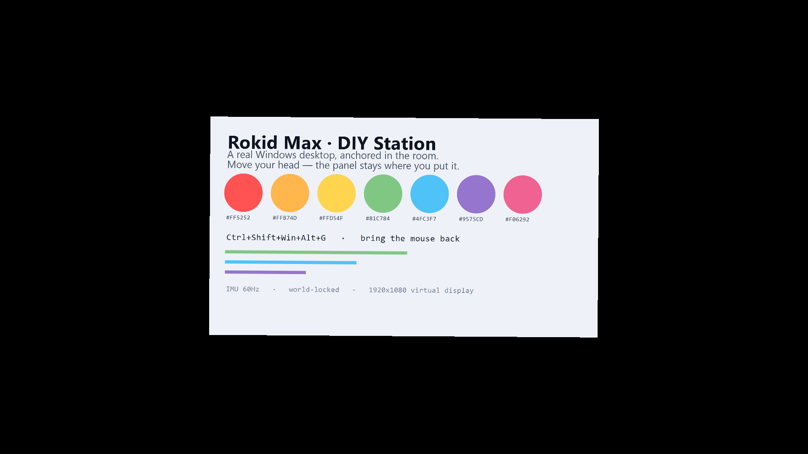
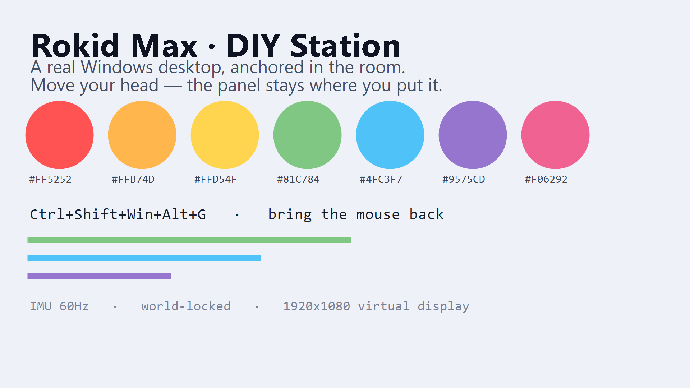

# Rokid Max · DIY Station

> **A real Windows desktop, floating in the air in your Rokid Max glasses.**
>
> Your apps, your taskbar, your files — anchored to a point in the room,
> not to your eyes. Move your head and the screen stays put.

[](https://github.com/CatKod/rokid-max-diy-station/releases/latest)
[](LICENSE)
[](https://learn.microsoft.com/windows)
[](https://dotnet.microsoft.com)

---

## 📖 The short version

The Rokid Max AR glasses have a 16:9 Micro-OLED display per eye, a 3-axis
IMU, and appear to Windows as an ordinary monitor. But normally they are
just… a monitor. You look at it, and the picture is glued to your eyeballs.

This project turns the glasses into a **spatial display**: a virtual
Windows monitor that lives in the room, is captured and re-projected onto
the glasses' display as a 3D-anchored quad, and is tracked by the glasses'
own IMU so it stays where you put it.

The result is that you can:

- **Drag any window from your real desktop into the glasses.** Not just
  browsers — Notepad, Explorer, Slack, VS Code, anything.
- **Click and type in it.** The mouse cursor is drawn *in the 3D scene*,
  and clicks land where you would expect them to.
- **Lean left and right** while reading, and the panel stays anchored to
  the world instead of sliding across your vision.

No phone. No Rokid Station box. No special runtime. Just the glasses and
a USB cable.

---

## 🖼 Screenshots

*Captured on real hardware — the panel image is the exact backbuffer that
reaches the Micro-OLED, written out by
[`tools/PanelSnapshot`](tools/PanelSnapshot).*

**The spatial panel, as it reaches the glasses:**



*The same frame as it comes off the capture — a real Windows desktop,
composed by DWM, with its taskbar and every window in its z-order:*



Both images were checked by a vision model: the text is legible, the
colour chips are in the right order, and **nothing is mirrored or
upside down**. That check is not optional — a "23% coverage" metric
reports mirroring, flipping and clipping as a pass, which is exactly why
`PanelSnapshot` exists.

---

## ✨ What it does

- **Reads the Rokid Max's onboard IMU** over USB HID — gyro, accelerometer
  and magnetometer — and fuses it into a stable 3 DoF head pose with a
  Mahony filter
- **Pins the virtual display in 3D space** on the glasses' Micro-OLED, so
  it tracks the world rather than the eyes
- **Draws a custom 3D mouse cursor** in the scene, with an adjustable size
  (0.25× – 4.0×)
- **Forwards every click, wheel tick and keystroke** — because the target is
  a *real* Windows display, the OS does all of it natively
- **Streams the head pose as FreeTrack-compatible UDP**, so OpenTrack and
  nearly every flight/sim game picks it up
- **Runs quietly in the system tray**, with optional autostart

### What makes it "real"

The important design decision: the panel is not a recorded video, and the
input is not synthesised.

There is a **virtual monitor** (an IddCx indirect display driver) sitting
in the Windows virtual desktop at negative coordinates, off to the side of
your real screens. Windows treats it as a genuine display. That means:

- the OS does the hit-testing, focus, z-order and activation
- **every** application works — not only Chromium ones
- drag-and-drop, context menus, scrollbars and text fields all behave
- the mouse cursor is the OS's own, so we only have to *draw* it in 3D

Everything the app does is feedback. The input is pure OS.

---

## 🛠 Tech stack

| Layer | Choice |
| --- | --- |
| Language | **C# / .NET 8** |
| App shell | WPF + `H.NotifyIcon.Wpf` tray icon |
| Graphics | **Direct3D 11** (flip-model swapchain), HLSL shaders compiled to DXBC at build time |
| Capture | **Windows.Graphics.Capture** (WGC) on a monitor handle |
| Display | **IddCx** virtual monitor via the Virtual Display Driver |
| IMU | `HidSharp` (a workaround for `HidLibrary` on some hosts) |
| Fusion | Mahony filter, custom implementation |
| Output | FreeTrack 2.x UDP protocol (port 5555) |
| Tests | xUnit — **218 passing** (73 app + 145 core) |

---

## 📦 Install

### 1. Get the app

Download `RokidDiyStation.exe` from the
[latest release](https://github.com/CatKod/rokid-max-diy-station/releases/latest).

It is **self-contained** — no .NET runtime installation needed. It is a
single file of roughly 180 MB.

### 2. Install the virtual display driver

The app needs a virtual monitor to project. That is a separate piece of
software:

```powershell
winget download --id VirtualDrivers.Virtual-Display-Driver -e
```

Then install it **as administrator**. The installation is not entirely
one-click — see
[the IddCx setup notes](docs/M12-TRUE-SPATIAL-DISPLAY.md#5-stage-0--done-verified-on-the-target-machine)
for the three non-obvious steps (certificate import, root devnode, and
where the settings file has to live).

> **The driver is the one part that needs administrator rights. Everything
> else — attaching and detaching the display at runtime — does not.**

### 3. Plug in the glasses and run it

1. Connect the Rokid Max over USB-C. It appears as an extra monitor
   (`\\.\DISPLAY5` on the reference machine).
2. Run `RokidDiyStation.exe`. It appears in the **system tray** (cyan "R")
   and starts on its own.
3. Open the settings window from the tray. The **Spatial display** row shows
   whether the virtual display was found and where it sits.
4. Drag a window from your desktop onto the virtual display area — it is
   off to the **left** of your primary screen, at negative coordinates.
5. Put the glasses on. The panel is there, in the room.

---

## 🎮 Hotkeys

All shortcuts use **four modifiers**, because single-modifier combos are
owned by other applications and fail silently when they are:

| Action | Shortcut |
| --- | --- |
| Set anchor here | `Ctrl+Shift+Win+Alt+Space` |
| Forget the panel | `Ctrl+Shift+Win+Alt+R` |
| Recenter view | `Ctrl+Shift+Win+Alt+C` |
| Show/hide settings window | `Ctrl+Shift+Win+Alt+H` |
| **Bring the mouse back** | `Ctrl+Shift+Win+Alt+G` |

Each action registers a **list of candidates**. If the first is already
taken by the OS or another app, the next is tried — the settings window
log names the combination that was actually bound. On the reference
machine, `Ctrl+Shift+Win+Alt+Space` was already owned by Windows, so
`Ctrl+Shift+Win+Alt+F1` was used instead.

**"Bring the mouse back"** exists because the virtual display sits at
negative coordinates: when the cursor crosses onto it, it leaves your
physical screen and the mouse feels lost. This one key brings it home.
It uses `MOD_NOREPEAT`, so holding it down does not yank the cursor back
repeatedly.

### Why not `Fn`?

`Fn+C` was the original request for this project, and it is **not possible
on a laptop**. The reason is worth understanding, because it is a hardware
boundary, not a software limitation:

> The `Fn` key is not a key the operating system ever sees.

`Fn` is handled by the laptop's **embedded controller** (EC) — a
microcontroller in the keyboard firmware. Measured with a low-level
keyboard hook on the development machine, pressing `Fn` alone produces
**no keyboard event at all**, and Windows has no `VK_FN` virtual-key code
for `RegisterHotKey` to use. The EC only intercepts `Fn+<key>`
*combinations* and converts them into the laptop's own functions —
brightness, volume, the numeric keypad, Airplane mode — in firmware,
before Windows ever sees the keystroke. Which combinations it intercepts
is a **BIOS setting**, not something an application can influence.

`Ctrl+Shift+Win+Alt` is the most-modified combination Windows offers that
still produces a real key event, so that is what the app uses.

---

## 🏗 Architecture

```
┌──────────────┐   USB HID    ┌───────────────────────────────┐
│  Rokid Max   │──────────────▶│         Core                 │
│  IMU + OLED  │               │  • Mahony fusion             │
└──────────────┘               │  • Spatial anchor            │
                               │  • FreeTrack UDP emitter      │
                               └──────────────┬────────────────┘
                                              │
        ┌─────────────────────────────────────┼──────────────────┐
        │                                     ▼                  │
        │   Windows virtual desktop           │                  │
        │   ┌──────────┐   ┌────────────┐    │                  │
        │   │ DISPLAY1 │   │  VIRTUAL   │    │                  │
        │   │  0,0     │   │  -1920,0   │◀───┘                  │
        │   │  primary │   │  1920x1080 │                       │
        │   └──────────┘   └────────────┘                       │
        └──────────┬───────────────────┬───────────────────────┘
                   │ WGC (monitor)      │ GetCursorInfo()
                   ▼                   ▼
             ┌───────────────────────────────────┐
             │        PanelRenderer (D3D11)      │
             │  • the desktop, as a 3D quad      │
             │  • the 3D mouse cursor            │
             │  • anchored by the IMU pose       │
             └────────────────┬──────────────────┘
                              ▼
                    Rokid Max Micro-OLED
```

### The three ideas that make it work

**1. The virtual monitor at negative coordinates.**
Windows forbids overlapping monitor rectangles, so the virtual display
cannot share coordinates with the Rokid Max's own display. It therefore
sits at `(-1920, 0)` — off to the left of your desktop. Windows has no
concept of an "off-screen" monitor: it is part of the virtual desktop, the
mouse reaches it normally, and the OS delivers clicks, focus and z-order
there exactly as anywhere else.

**2. Capture the monitor, not a window.**
`IGraphicsCaptureItemInterop::CreateForMonitor` grabs the DWM-composed
desktop of that display — wallpaper, every window in its z-order, the
taskbar. It is immune to occlusion by unrelated windows, which is why it
beats DXGI Desktop Duplication.

**3. The cursor is pure feedback.**
With a real display, the OS does all the input work. The app only reads
`GetCursorInfo()`, maps it into the monitor's UV space, and draws the 3D
cursor there. That mapping is a plain affine transform with no gain and no
drift, because the virtual monitor's pixel grid *is* the content's pixel
grid.

---

## 📂 Project layout

```
rokid-max-diy-station/
├── src/
│   ├── RokidDiyStation.App/          # WPF tray app, D3D11 renderer, spatial station
│   ├── RokidDiyStation.Core/         # IMU, fusion, anchor maths, protocols (no UI)
│   └── RokidDiyStation.Cli/          # headless testing tool
├── tests/
│   ├── RokidDiyStation.Core.Tests/   # 145 tests
│   └── RokidDiyStation.App.Tests/    # 73 tests
├── tools/                            # probes and verification tools (20 of them)
├── drivers/                          # USB IDs / HID descriptor notes
├── docs/                             # milestone and protocol documents
└── README.md
```

---

## 🔧 The CLI

The tray app is the product, but there is a headless companion for
development, debugging and CI:

```powershell
dotnet run --project src/RokidDiyStation.Cli -- discover
#   Rokid Max          VID=0x04D2  PID=0x162F  serial=...

dotnet run --project src/RokidDiyStation.Cli -- stream --timeout 10
#   ts_ns  accel_x  accel_y  accel_z  gyro_x  ...  worn

dotnet run --project src/RokidDiyStation.Cli -- parse <hex-frame>
#   decode a single captured frame

dotnet run --project src/RokidDiyStation.Cli -- fusion-emit --replay <capture.bin>
#   replay a binary capture and emit FreeTrack UDP packets
```

The `discover-sharp` / `stream-sharp` / `diagnose-sharp` variants use the
`HidSharp` backend, which exists because `HidLibrary` fails to open the
device on some hosts.

---

## 🔬 Verifying it on real hardware

```powershell
# Live IMU + panel metrics on the connected glasses
dotnet run --project tools/SpatialSelfTest

# Write the exact backbuffer reaching the Micro-OLED to a PNG
dotnet run --project tools/PanelSnapshot -- artifacts/panel.png

# Is the virtual display behaving like a real display?
dotnet run --project tools/ProbeVirtualDisplay

# Put a clean, colourful window on the virtual display, so a
# screenshot has something worth looking at
dotnet run --project tools/VividDesktop
```

`PanelSnapshot` matters more than it looks: a "23% coverage" metric
reports mirroring, flipping and clipping as a **pass**. The PNG is how you
catch them.

---

## 🐛 Known limitations

These are real, and they are not hidden:

- **The driver needs administrator rights to install**, and it is not
  attested. It fails outright on Windows 11 ARM64.
- **Windows spawns windows on the primary display.** You drag them across,
  or use `Win+Shift+Arrow`.
- **The system tray stays on the primary display.** A secondary monitor
  gets the Start button but no tray.
- **The 3D cursor can lag the OS cursor by one frame**, since it is
  updated on the render tick.
- **The cursor shape is static.** It does not become an I-beam over text.
- **Only Windows.** macOS and Linux are not supported.
- **The Rokid Max only.** The Rokid Air is unverified.

---

## 📚 Documentation

| Document | What it covers |
| --- | --- |
| [M12 — True Spatial Display](docs/M12-TRUE-SPATIAL-DISPLAY.md) | The architecture, why the virtual display driver is back on the table, and the honest costs |
| [M11 — Custom Hardware Cursor](docs/M11-CUSTOM-HARDWARE-CURSOR.md) | Mapping the physical mouse onto the spatial panel |
| [M10 — Input Layer Stack](docs/M10-INPUT-LAYER-STACK.md) | The input bridge, and why the OS now does the work instead |
| [M9 — Spatial Pointer Bridge](docs/M9-SPATIAL-POINTER-BRIDGE.md) | The pointer mapping |
| [M8 — Interactive Panel](docs/M8-INTERACTIVE-PANEL.md) | Why the first two attempts failed |
| [M7 — Full-screen anchoring limits](docs/M7-FULL-SCREEN-ANCHORING-LIMITS.md) | The Windows CCD rules and why they bite |
| [M5 — Spatial anchoring](docs/M5-SPATIAL-ANCHORING.md) | The anchor maths and the calibration recipe |
| [PROTOCOL.md](docs/PROTOCOL.md) | The USB HID packet layout, byte by byte |
| [ROADMAP.md](ROADMAP.md) | What is done and what is next |

---

## 🤝 Contributing

Issues, IMU captures, protocol dumps and PRs are all welcome — especially
anything you learn while sniffing Rokid Max USB traffic, and reports from
machines other than the reference one.

- **Report a bug:** [GitHub issues](https://github.com/CatKod/rokid-max-diy-station/issues)
- **Download:** [latest release](https://github.com/CatKod/rokid-max-diy-station/releases/latest)
- **Reddit announcement:** [r/rokid post draft](docs/community/reddit-post.md)

If you are new to the codebase, the
[milestone documents](docs/) are the best guide: each one explains not
just *what* was built but *why the previous approach failed*, which is the
part that is hard to reconstruct from the code.

---

## 📜 License

MIT — see [LICENSE](LICENSE).
