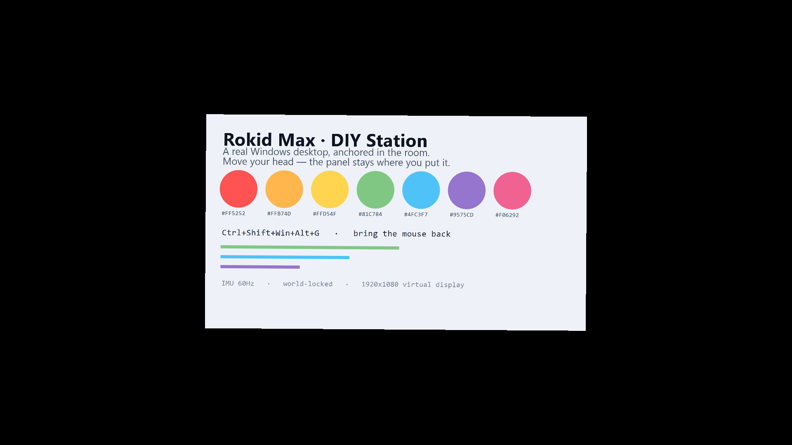
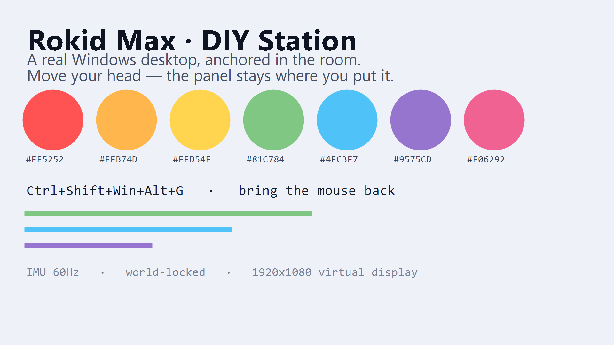

# I built a tool that turns Rokid Max into a real spatial desktop — anchor any Windows app in your room

I bought Rokid Max glasses because the spec sheet said "3DoF head tracking" and I got excited. What I didn't research properly is that the spatial experience doesn't work standalone — the Rokid Station is what makes it actually usable as a floating screen. So I bought one, was underwhelmed, and went looking.

There are existing tools that project a browser tab or a single window onto the glasses. I tried them. They're fine for what they are, but they're not a real desktop: you get a mirrored or projected window, interaction is limited, some require launching Chrome with a remote debugging flag, and it all feels like a workaround rather than a thing that works.

So I built my own.

---

**Repo:** https://github.com/CatKod/rokid-max-diy-station
**Download (single .exe, no .NET install needed):** https://github.com/CatKod/rokid-max-diy-station/releases/tag/v0.3.2

---

## What it does

The core idea: your glasses become a real Windows monitor anchored in the room. You drag any window onto it — Notepad, VS Code, Slack, Explorer, whatever — interact with it normally, and when you move your head the panel stays where you put it.

Concretely:

- Reads the onboard IMU (gyro + accel + magnetometer) over USB HID — VID 0x04D2 / PID 0x162F, report ID 0x11, 64-byte packets at ~436 Hz — and fuses it into a stable 3DoF head pose with a Mahony filter
- Renders the panel as a 3D quad on the glasses' Micro-OLED using D3D11, a flip-model swapchain, and HLSL shaders, anchored to the world via the IMU
- The panel's size is adjustable from **25 % to 100 %** of the field of view, applied live — it grows and shrinks *in place*, keeping its position in the room
- Draws a 3D mouse cursor in the scene, adjustable from 0.25× to 4.0×, applied live
- Works with **any** Windows app, not just Chromium-based ones
- Runs in the system tray with optional autostart, and has a **reload** action for when it gets into a bad state
- Also emits the head pose as a FreeTrack-compatible UDP stream, so OpenTrack / flight sims / space sims can use the glasses as a head tracker

## How it actually works (the interesting part)

The naive approach is: capture a window, draw it on a quad. I tried that twice and hit a hard wall. Because the AR panel is a topmost opaque window covering the glasses' display, Win32 can't deliver clicks to the window behind it. So you end up having to fake input at the application layer — which is why the old version only really worked with Chromium apps launched with a remote debugging flag, and needed a CDP client, a keyboard hook, a mouse hook, and about 2,000 lines of code whose entire job was to simulate what the OS does natively.

The fix was to stop faking it entirely:

**1. A virtual monitor.** An IddCx indirect display driver creates a real Windows monitor at negative coordinates (−1920, 0), off to the left of your physical displays. Windows doesn't have an "off-screen" concept — the monitor is a full citizen of the virtual desktop. The mouse reaches it. The OS delivers clicks, focus, z-order, and drag-and-drop there exactly like any other monitor.

**2. Capture the monitor, not a window.** `IGraphicsCaptureItemInterop::CreateForMonitor` grabs the DWM-composed desktop of that display — wallpaper, every window in its z-order, the taskbar. It's immune to occlusion by other windows, no matter what.

**3. The cursor is pure feedback.** Because the OS handles all the input, the app just reads `GetCursorInfo()`, maps it into the monitor's UV space, and draws the 3D cursor. It's a plain affine transform — no gain, no drift — because the virtual monitor's pixel grid *is* the content's pixel grid.

**4. The panel's size is angular, not metric.** The slider sets what fraction of the glasses' field of view the panel covers (25 %–100 %). Because the width is computed from the *angle* and the distance, moving the panel further away doesn't change how big it looks — only how far away it is. And because the mouse cursor is sized as a fraction of the *panel's width* rather than as a fixed size in metres, the two settings don't silently undo each other. Both of those were wrong in the first version, and both were only visible once you could actually move the slider.

The whole CDP stack was deleted. ~2,000 lines became ~80. And every application works.

Written in C# / .NET 8 — WPF tray shell, D3D11 renderer, Windows Graphics Capture for the display feed, HidSharp for USB HID. 345 tests passing.

## Screenshots

These are real — the panel screenshot is the exact pixel data from the D3D11 backbuffer reaching the Micro-OLED. I verified it wasn't accidentally mirrored or flipped by running it through a vision model check (the coverage metric reports mirroring as a pass, so it actually matters to confirm this explicitly).

**Panel rendered in 3D, as it appears on the Micro-OLED:**

**The virtual display being captured and projected:**

## Honest limitations

- The virtual display driver (VirtualDrivers.Virtual-Display-Driver) is a separate install and needs admin rights **once**. After that, the app attaches and detaches it at runtime without elevation.
- The driver is not WHQL-signed and **does not work on Windows 11 ARM64**.
- Windows still opens new windows on your primary display by default — you drag them over, or use Win+Shift+Arrow.
- The system tray stays on your primary display.
- The 3D cursor can lag the OS cursor by one frame.
- The cursor shape is static — it doesn't become an I-beam over text fields yet.
- Windows only. Only the Rokid Max is verified; Rokid Air is untested.
- It's a work in progress with plenty of bugs I haven't found yet.

## If this is useful to you

This started as me just wanting the thing to work. If it's useful to you too, a GitHub star goes a long way for a solo project like this.

Bug reports are genuinely welcome — especially if you hit a crash on first launch, driver issues, or anything IMU-related. The more feedback I get, the more I can prioritize what to fix.

https://github.com/CatKod/rokid-max-diy-station

---

Not affiliated with Rokid. Feedback and bug reports are welcome on GitHub issues: https://github.com/CatKod/rokid-max-diy-station/issues
